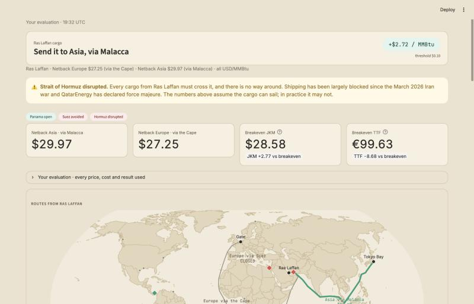
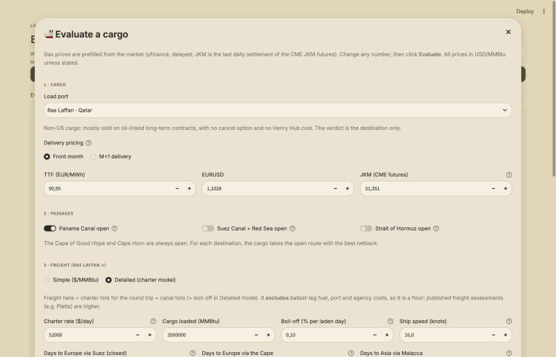
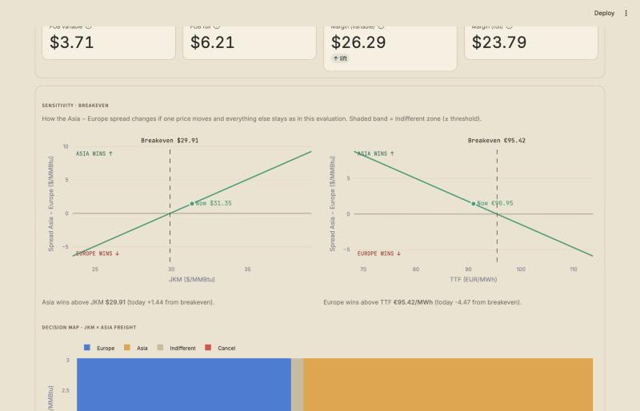

# 🚢 LNG Arbitrage Dashboard: Europe or Asia?

A Streamlit dashboard that answers one trading-desk question:

> **An LNG cargo is loading at a major export terminal. Should it go to Europe or to Asia right now, and by how much does the winner win?**

For US cargoes it also answers the offtaker's question behind it: **lift the cargo, or cancel it?**


---

## What it does

1. **Covers nine real load ports.** Every route uses real sea distances.
   - **US** (Henry Hub-linked, with lift/cancel): Sabine Pass, Corpus Christi, Cove Point.
   - **Elsewhere** (destination verdict only): Ras Laffan (Qatar), Gladstone (Australia), Kitimat (LNG Canada), Bonny Island (Nigeria), Hammerfest (Norway), Point Fortin (Trinidad).
2. **Models the passages that matter in 2026.** Each one has an open/closed switch, set by default to the market situation in November 2026:
   - **Panama:** open but congested.
   - **Suez + Red Sea:** avoided since the Houthi attacks.
   - **Strait of Hormuz:** disrupted since the March 2026 Iran war.

   The Cape of Good Hope and Cape Horn are always open. For each destination the cargo takes the **open route with the best netback**. Qatar has no way around Hormuz, so a Ras Laffan cargo gets a clear **warning** instead.
3. **Pulls market prices** (delayed): Henry Hub, TTF and EURUSD, the CME JKM futures settlement, and the HH and TTF contract months.
4. **Opens an "Evaluate a cargo" pop-up**. The gas prices are prefilled from the market and editable. They can be priced two ways:
   - **Front month:** HH and TTF front month.
   - **M+1 delivery:** HH for the loading month (e.g. Dec-26) and TTF for the month the cargo arrives in Europe (Jan-27), the way a real cargo prices.

   Freight is entered in one of two modes:
   - **Simple:** USD/MMBtu per route.
   - **Detailed:** a charter model (charter rate × round-trip days from distance ÷ ship speed, Panama and Suez tolls, cargo size, boil-off), with a freight build-up table.
5. **Gives the verdict straight away**, in plain English with the gain next to it:
   - US ports: "Send it to Asia, via Panama · +$1.44/MMBtu" (a LIFT), "Send it to Europe", "Either way" (indifferent) or "Cancel the cargo".
   - Other ports: "Send it to Asia, via Malacca · +$2.72/MMBtu".

   Under it: a price strip (HH, TTF, JKM, EURUSD with status dots), the passage tags and four key numbers (both netbacks, the breakeven JKM, and the margin or the breakeven TTF).
6. **Draws the routes** on a world map along real sea lanes:
   - each route is labelled with its netback, and the winner is highlighted;
   - closed routes are dashed;
   - every passage is coloured by status.
7. **Shows the full breakdown**: netbacks per route (hub price − regas − boil-off loss − freight), and for US ports the FOB cost and margins.
8. **Stress-tests the decision**:
   - **breakeven charts** give the exact JKM and TTF levels where the cargo flips destination;
   - a **decision map** colours every JKM × freight combination by outcome.
9. **Records what was done**: a fold-out "Your evaluation" panel keeps a summary of the evaluation, with every price labelled "market" or "your input".
10. **Logs the live arb** for a Sabine Pass cargo: every 5 minutes it re-prices the market and appends one row to a CSV log.
11. **Shows 12 years of arb history** for a Sabine Pass cargo, in a **History** tab: every month since mid-2014 priced with the same formulas, with
    - the **arb over time**, one bar per month coloured by winner (the 2022 energy crisis, when Europe outbid Asia by up to $17/MMBtu, stands out);
    - **win rates**: how often Europe, Asia, neither, or cancelling won, overall and per year;
    - **seasonality**: the average spread per calendar month (Asia pays more from October to January);
    - a **1Y / 3Y / 5Y / All** selector and a CSV download.








---

## The economics

All values in **USD/MMBtu**, per MMBtu **loaded**.

| Step | Formula |
|---|---|
| TTF in dollars | `TTF (EUR/MWh) × EURUSD ÷ 3.412` (1 MWh = 3.412 MMBtu) |
| Cost of a US cargo | `FOB variable = 115% × Henry Hub` (feed gas, the only avoidable cost)<br>`FOB full = FOB variable + liquefaction fee` |
| Voyage days | `distance (nautical miles) ÷ (ship speed × 24)`, e.g. 9,306 nm at 16 knots = 24 days |
| Freight (Detailed mode) | `(charter rate × round-trip days + canal tolls) ÷ cargo size`. The ship is paid out **and** back; each canal is transited twice |
| Boil-off (Detailed mode) | `boil-off rate per day × laden days` (e.g. 0.10%/day × 13 days = 1.3%) |
| Netback | `(hub price − regas) × (1 − boil-off) − freight` |
| Route | For each destination, the **open** route with the highest netback. A route is closed if any passage on it is closed |
| Destination | `spread = Netback Asia − Netback Europe`. Below the threshold ($0.10 by default), the verdict is **Indifferent** |
| Lift or cancel (US only) | The liquefaction fee is **sunk**, so the cargo is cancelled only if the best netback is below **115% HH**. A cargo can lose money after the fee and still be worth lifting |
| Non-US cargoes | Mostly sold on oil-linked long-term contracts with no cancel option, so the answer is the **destination only** (no FOB cost, margin or Cancel) |
| Breakeven JKM | `regas Asia + (netback Europe + freight) ÷ (1 − boil-off)`, using the cheapest open Asia route |
| M+1 delivery | Futures roll before the month starts, so in November the front month is December (loading) and M+1 is January (delivery). Yahoo tickers like `TTFF27.NYM` = TTF, **F** = January, 2027 |
| History, per month | The same calculation for Sabine Pass, with that month's average HH, Europe gas and JKM prices and **today's** freight, regas and fees |

*Netback = what the cargo is worth back at the load port after regasification, boil-off and shipping.*

**Why routes matter:** from Gladstone, Europe via the Cape ($1.60/MMBtu freight) beats Europe via Panama ($1.84): two canal transits cost more than the extra sailing days. From Ras Laffan with Suez avoided, Europe is 29 days away via the Cape instead of 17 via Suez.

---

## Built like a desk tool

- **One data module.** Every price enters through [`market_data.py`](market_data.py), as a standard `Quote` (value, unit, source, timestamp, status). No other file knows the vendor exists. Moving from yfinance to **Bloomberg, ICE or Platts** means changing that one file.
- **Every price carries its source, timestamp and a status light.** 🟢 fresh (under 20 min) · 🟡 delayed (20 to 60 min) · 🔴 stale (over 60 min, or the fetch failed). A price converted from two inputs (TTF in USD) takes the older timestamp and the worse light.
- **Never crashes on bad data.** If a feed is down, the app shows red lights, and the trader can still evaluate a cargo by typing prices; a price left at zero is refused with a clear message. The map and charts still work. If the history can't be downloaded, the History tab says so and tries again on the next visit.
- **Clear separation:**
  - formulas: [`arb_calc.py`](arb_calc.py)
  - data: [`market_data.py`](market_data.py)
  - charts: [`charts.py`](charts.py), which draws only and does no maths
  - history: [`arb_log.py`](arb_log.py)
  - screens: [`app.py`](app.py)
  - settings, ports, routes and distances: [`config.py`](config.py)
- **Self-built history.** One CSV row per price refresh: 28 columns covering prices, timestamps, statuses, costs, netbacks, route, verdict and margins. Exactly one row per fetch, even with several browser tabs open.
- **Tested.** 77 automated tests, all offline, including:
  - hand-calculated arb cases;
  - the freight and boil-off worked example;
  - breakevens, checked to give a spread of exactly zero;
  - decision-map cells, including a route switch from Panama to the Cape;
  - every port: closed passages fall back to the best open route, and each port can always reach both destinations;
  - Sabine Pass with Suez avoided gives exactly the earlier (V3) results;
  - non-US ports give a destination-only verdict; Ras Laffan raises the Hormuz warning;
  - contract-month tickers (e.g. 14 Nov 2026 → `TTFZ26.NYM` front, `TTFF27.NYM` M+1; December rolls into the next year);
  - the monthly history: JKM monthly averages, the arb per month, win rates and seasonality, against hand calculations;
  - the status-light rules, offline behaviour and the log.

---

## Data sources and limitations

| Data | Source | Note |
|---|---|---|
| Henry Hub (`NG=F`) | yfinance | Delayed, front month |
| TTF (`TTF=F`) | yfinance | Delayed, front month, EUR/MWh |
| EURUSD (`EURUSD=X`) | yfinance | Delayed |
| JKM (`JKM=F`) | yfinance | **CME JKM futures, front month, daily settlement**. It can differ from the Platts JKM spot assessment by $1–2/MMBtu; the box is editable for a spot price |
| HH and TTF contract months (e.g. `NGZ26.NYM`, `TTFF27.NYM`) | yfinance | Delayed. Used for M+1 delivery pricing |
| Europe gas history (`PNGASEUUSDM`) | FRED (IMF) | Monthly average, USD/MMBtu, TTF-based |
| Henry Hub history (`PNGASUSUSDM`) | FRED (IMF) | Monthly average, USD/MMBtu |
| JKM history (`JKM=F`) | yfinance | Daily settlements since Jul-2014, averaged by month |
| Sea distances and route lines | [searoute](https://github.com/genthalili/searoute-py) (Eurostat MARNET sea lanes) | Within ~1% of published US Gulf → Japan figures (Panama 9,306 vs 9,209 nm, Suez 14,624 vs 14,521, Cape 15,825 vs 15,689) |
| Charter rate default ($52,000/day) | IndexBox, late Oct 2026 | One-year time-charter rate. Spot ranged from ~$25k (US Gulf→Europe) to ~$59k (US Gulf→Japan) |
| Panama toll ($500k per transit) | Panama Canal 2024 tariff | ~$620k laden, less in ballast, before any slot-auction premium |
| Passage defaults | Trade press, Nov 2026 | Lloyd's List, Bloomberg/OilPrice, Panama Canal Authority figures; see SPEC.md 14.1 |
| Regas, liquefaction fee, Suez toll, cargo size | Trader input | Editable placeholders. The Suez toll ($450k) is unverified |

- yfinance data is **delayed and unofficial**: indicative only, **not for trading**.
- **Freight is a floor:** it covers charter hire, canal tolls and boil-off, but **not** ballast-leg fuel, port or agency costs. Published freight assessments (e.g. Platts) are higher.
- **Passage statuses are not live.** They are the November 2026 situation, set as defaults, and must be switched by hand when the news changes.
- **The verdict can hinge on which JKM is used:** with the CME futures it may say Asia, with the Platts spot it may say Europe. Check the breakeven chart.
- **Russia** (sanctions) and the **Northern Sea Route** (summer only, ice-class ships) are left out.
- The History tab and the 5-minute refresh log are for a **Sabine Pass** cargo (Panama or Cape). The history applies **today's** freight, regas and fees to every month (their history isn't free anywhere), so it shows how gas prices alone moved the arb. FRED's Europe series is an IMF monthly average, close to but not exactly TTF.
- The refresh log uses front-month prices and only builds while the app is open in a browser.
- M+1 pricing doesn't handle the few days around expiry specially.
- Boil-off is applied on the laden leg only; the ballast leg returns the same way it came.
- Kitimat sits at the end of a fjord, so its distances are slightly understated (~0.7%).
- Map routes are simplified sea lanes, not exact shipping tracks.

---

## Run it

Requires Python 3.12+.

```bash
python3 -m venv .venv
source .venv/bin/activate
pip install -r requirements.txt
streamlit run app.py
```

The dashboard opens at `http://localhost:8501`.

Run the tests:

```bash
pytest
```

---

## Project structure

```
lng_arbitrage/
├── app.py                 # Screens: price strip, verdict card, Evaluate and History tabs, pop-up, evaluation summary, live market, log
├── market_data.py         # THE data module: prices, contract months, monthly history (Quote and History objects)
├── arb_calc.py            # Pure formulas: netbacks, freight & boil-off, best open route per port, breakevens, history stats
├── charts.py              # Plotly map and charts: routes and passages, breakevens, heatmap, arb over time, win rates, seasonality
├── arb_log.py             # CSV refresh log: one row per price refresh
├── config.py              # Tickers, FRED series, load ports, routes and distances, passages, defaults, map lines
├── .streamlit/config.toml # Parchment theme (warm page, paper cards, charcoal accent)
├── tests/                 # 77 pytest tests
├── docs/                  # Screenshots
├── SPEC.md                # Full specification (V1 to V4: scope, formulas, screens, done criteria)
└── requirements.txt       # Pinned library versions
```

---

## Roadmap

| Version | Scope | Status |
|---|---|---|
| **V1** | Calculator with market data, cargo evaluation pop-up, status lights, auto refresh and refresh log | ✅ Done |
| **V2** | Freight & boil-off model, dark terminal design, route map, breakeven charts, decision heatmap | ✅ Done |
| **V3** | Historical arb since 2014 (FRED + Yahoo): arb over time, win rates, seasonality; M+1 delivery pricing | ✅ Done |
| **V4** | Nine real load ports, real sea distances, Panama / Suez / Cape / Hormuz passages, destination-only verdict for non-US cargoes; design refresh (parchment cards, price strip, plain-English verdict) | ✅ Done |
| Next | Publish online on Streamlit Community Cloud | Planned |

---

## About

Built by **Jalil Bennani**, a former gas trader (TTF, biomethane), now studying for the Master in Financial Analysis at London Business School. It's a learning project in Python, built around a question I used to answer on the desk.

*Indicative tool for education and portfolio purposes. Not investment advice.*
