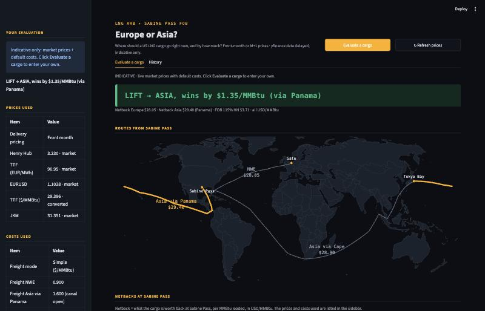
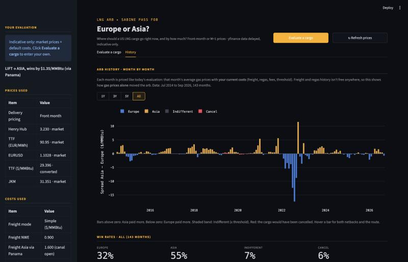
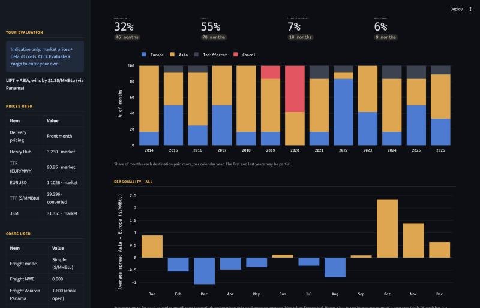

# 🚢 LNG Arbitrage Dashboard: Sabine Pass, Europe or Asia?

A Streamlit dashboard that answers one trading-desk question:

> **A US LNG cargo is loading at Sabine Pass. Should it go to Europe or to Asia right now, and by how much does the winner win?**

It also answers the offtaker's question behind it: **lift the cargo, or cancel it?**



---

## What it does

1. **Pulls market prices** (delayed): Henry Hub, TTF and EURUSD, the latest JKM settlement, and the HH and TTF contract months.
2. **Opens an "Evaluate a cargo" pop-up**. The gas prices are prefilled from the market and editable. They can be priced two ways:
   - **Front month:** HH and TTF front month.
   - **M+1 delivery:** HH for the loading month (e.g. Dec-26) and TTF for the month the cargo arrives in Europe (Jan-27), the way a real cargo prices.

   Freight is entered in one of two modes:
   - **Simple:** USD/MMBtu per route.
   - **Detailed:** a charter model (charter rate × round-trip days, Panama tolls, cargo size, boil-off), with a freight build-up table.
3. **Gives the verdict straight away**, e.g. `LIFT → ASIA, wins by $0.90/MMBtu (via Panama)`, `LIFT → EUROPE`, `INDIFFERENT` or `CANCEL`.
4. **Draws the routes** on a world map: Sabine Pass → North-West Europe, → North Asia via Panama, → North Asia via the Cape of Good Hope. Each route is labelled with its netback and the winner is highlighted.
5. **Shows the full breakdown**: netbacks (hub price − regas − boil-off loss − freight), FOB cost and margins.
6. **Stress-tests the decision**:
   - **breakeven charts** give the exact JKM and TTF levels where the cargo flips destination;
   - a **decision map** colours every JKM × freight combination by outcome.
7. **Records what was done**: the sidebar keeps a summary of the evaluation, with every price labelled "market" or "your input".
8. **Logs the live arb**: every 5 minutes it re-prices the market and appends one row to a CSV log.
9. **Shows 12 years of arb history** in a **History** tab: every month since mid-2014 priced with the same formulas, with
   - the **arb over time**, one bar per month coloured by winner (the 2022 energy crisis, when Europe outbid Asia by up to $17/MMBtu, stands out);
   - **win rates**: how often Europe, Asia, neither, or cancelling won, overall and per year;
   - **seasonality**: the average spread per calendar month (Asia pays more from October to January);
   - a **1Y / 3Y / 5Y / All** selector and a CSV download.






---

## The economics

All values in **USD/MMBtu**, per MMBtu **loaded**.

| Step | Formula |
|---|---|
| TTF in dollars | `TTF (EUR/MWh) × EURUSD ÷ 3.412` (1 MWh = 3.412 MMBtu) |
| Cost of the cargo at Sabine Pass | `FOB variable = 115% × Henry Hub` (feed gas, the only avoidable cost)<br>`FOB full = FOB variable + liquefaction fee` |
| Freight (Detailed mode) | `(charter rate × round-trip days + canal tolls) ÷ cargo size`. The ship is paid out **and** back; Panama is transited twice |
| Boil-off (Detailed mode) | `boil-off rate per day × laden days` (e.g. 0.10%/day × 14 days = 1.4%) |
| Netback | `(hub price − regas) × (1 − boil-off) − freight` |
| Asia route | **Panama** or the **Cape**, whichever gives the higher netback (Panama can be switched off) |
| Destination | `spread = Netback Asia − Netback Europe`. Below the threshold ($0.10 by default), the verdict is **Indifferent** |
| Lift or cancel | The liquefaction fee is **sunk**, so the cargo is cancelled only if the best netback is below **115% HH**. A cargo can lose money after the fee and still be worth lifting |
| Breakeven JKM | `regas Asia + (netback Europe + freight) ÷ (1 − boil-off)`, using the cheapest open Asia route |
| M+1 delivery | Futures roll before the month starts, so in November the front month is December (loading) and M+1 is January (delivery). Yahoo tickers like `TTFF27.NYM` = TTF, **F** = January, 2027 |
| History, per month | The same calculation, with that month's average HH, Europe gas and JKM prices and **today's** freight, regas and fees |

*Netback = what the cargo is worth back at Sabine Pass after regasification, boil-off and shipping.*

**Why boil-off matters:** a longer voyage loses more cargo. In one test case, the simple model says *Asia by $0.12* but the detailed model says *Europe by $0.11*: the 25-day Asia voyage burns 2.5% of the cargo against 1.4% to Europe.

---

## Built like a desk tool

- **One data module.** Every price enters through [`market_data.py`](market_data.py), as a standard `Quote` (value, unit, source, timestamp, status). No other file knows the vendor exists. Moving from yfinance to **Bloomberg, ICE or Platts** means changing that one file.
- **Every price carries its source, timestamp and a status light.** 🟢 fresh (under 20 min) · 🟡 delayed (20 to 60 min) · 🔴 stale (over 60 min, or the fetch failed). A price converted from two inputs (TTF in USD) takes the older timestamp and the worse light.
- **Never crashes on bad data.** If a feed is down, the app shows red lights, and the trader can still evaluate a cargo by typing prices. The map and charts still work. If the history can't be downloaded, the History tab says so and tries again on the next visit.
- **Clear separation:**
  - formulas: [`arb_calc.py`](arb_calc.py)
  - data: [`market_data.py`](market_data.py)
  - charts: [`charts.py`](charts.py), which draws only and does no maths
  - history: [`arb_log.py`](arb_log.py)
  - screens: [`app.py`](app.py)
  - settings: [`config.py`](config.py)
- **Self-built history.** One CSV row per price refresh: 28 columns covering prices, timestamps, statuses, costs, netbacks, route, verdict and margins. Exactly one row per fetch, even with several browser tabs open.
- **Tested.** 61 automated tests, all offline, including:
  - hand-calculated arb cases;
  - the freight and boil-off worked example;
  - breakevens, checked to give a spread of exactly zero;
  - decision-map cells, including a route switch from Panama to the Cape;
  - contract-month tickers (e.g. 14 Nov 2026 → `TTFZ26.NYM` front, `TTFF27.NYM` M+1; December rolls into the next year);
  - the monthly history: JKM monthly averages, the arb per month, win rates and seasonality, against hand calculations;
  - the status-light rules, offline behaviour and the log.

---

## Data sources and limitations

| Data | Source | Note |
|---|---|---|
| Henry Hub (`NG=F`) | yfinance | Delayed, front month |
| TTF (`TTF=F`) | yfinance | Delayed, front month, EUR/MWh |
| EURUSD (`EURUSD=X`) | yfinance | Delayed |
| JKM (`JKM=F`) | yfinance | **Daily settlement only** (CME JKM futures, settled on Platts). Used as an editable prefill |
| HH and TTF contract months (e.g. `NGZ26.NYM`, `TTFF27.NYM`) | yfinance | Delayed. Used for M+1 delivery pricing. No JKM contract months on Yahoo, so JKM stays the daily settlement |
| Europe gas history (`PNGASEUUSDM`) | FRED (IMF) | Monthly average, USD/MMBtu, TTF-based |
| Henry Hub history (`PNGASUSUSDM`) | FRED (IMF) | Monthly average, USD/MMBtu |
| JKM history (`JKM=F`) | yfinance | Daily settlements since Jul-2014, averaged by month |
| Freight, voyage days, charter rate, regas, fees | Trader input | No free market feed. Detailed-mode defaults are editable placeholders |

- yfinance data is **delayed and unofficial**: indicative only, **not for trading**.
- The History tab is **monthly** and applies **today's** freight, regas and fees to every month (their history isn't free anywhere), so it shows how gas prices alone moved the arb. FRED's Europe series is an IMF monthly average, close to but not exactly TTF.
- The 5-minute refresh log uses front-month prices and only builds while the app is open in a browser.
- M+1 pricing doesn't handle the few days around expiry specially.
- Boil-off is applied on the laden leg only. Bunker fuel, port costs and the Suez route are not modelled.
- Map routes are simplified sea lanes, not exact shipping tracks.

---

## Run it

Requires Python 3.12+.

```bash
python3 -m venv .venv
source .venv/bin/activate
pip install -r requirements.txt
streamlit run app.py
```

The dashboard opens at `http://localhost:8501`.

Run the tests:

```bash
pytest
```

---

## Project structure

```
lng_arbitrage/
├── app.py                 # Screens: Evaluate and History tabs, pop-up, sidebar summary, live market, log
├── market_data.py         # THE data module: prices, contract months, monthly history (Quote and History objects)
├── arb_calc.py            # Pure formulas: netbacks, freight & boil-off, breakevens, decision grid, history stats
├── charts.py              # Plotly map and charts: breakevens, heatmap, arb over time, win rates, seasonality
├── arb_log.py             # CSV refresh log: one row per price refresh
├── config.py              # Tickers, FRED series, default costs, voyage defaults, map coordinates, thresholds
├── .streamlit/config.toml # Dark trading-terminal theme
├── tests/                 # 61 pytest tests
├── docs/                  # Screenshots
├── SPEC.md                # Full specification (V1, V2 and V3: scope, formulas, screens, done criteria)
└── requirements.txt       # Pinned library versions
```

---

## Roadmap

| Version | Scope | Status |
|---|---|---|
| **V1** | Calculator with market data, cargo evaluation pop-up, status lights, auto refresh and refresh log | ✅ Done |
| **V2** | Freight & boil-off model, dark terminal design, route map, breakeven charts, decision heatmap | ✅ Done |
| **V3** | Historical arb since 2014 (FRED + Yahoo): arb over time, win rates, seasonality; M+1 delivery pricing | ✅ Done |
| Next | Publish online on Streamlit Community Cloud | Planned |

---

## About

Built by **Jalil Bennani**, a former gas trader (TTF, biomethane), now studying for the Master in Financial Analysis at London Business School. It's a learning project in Python, built around a question I used to answer on the desk.

*Indicative tool for education and portfolio purposes. Not investment advice.*
